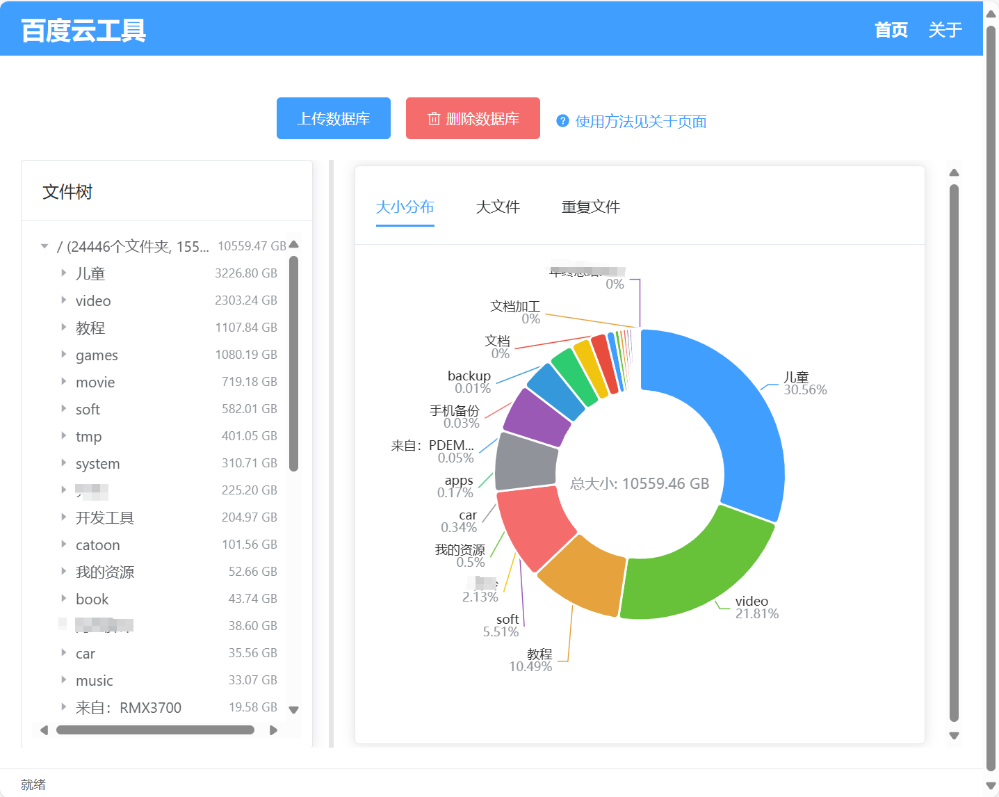

# 百度云工具（BaiduYunTools）

一个用于分析百度网盘本地缓存数据的桌面工具：无需登录、无需联网，直接读取客户端缓存索引，可视化查看网盘的文件结构、目录占用、大文件与重复文件，帮助你快速清理空间。

> 来源说明：本项目基于 [https://gitee.com/qingchunquan/baiduyuntools](https://gitee.com/qingchunquan/baiduyuntools) 的原始项目进行二次开发，新增了缓存自动定位、桌面端打包（单文件 exe）等功能，感谢原作者的分享。



## 下载与安装

- **Windows 单文件版（推荐）**：前往 [Releases](https://github.com/sj7510/baiduyuntools/releases) 下载 `BaiduYunTools.exe`，双击即可运行，无需安装 Python、Node.js 或任何依赖。
- 首次运行若被 Windows SmartScreen 拦截，点击“更多信息 → 仍要运行”即可（exe 未做代码签名）。

## 主要功能

- **一键查找缓存**：自动扫描百度网盘客户端的缓存数据库，兼容新版 `filecache.db` 与旧版 `BaiduYunCacheFileV0.db`，校验后直接使用，无需手动复制文件。
- **目录占用分析**：文件树懒加载浏览，饼图/图表展示顶层目录空间占比。
- **文件类型统计**：按扩展名分类统计视频、压缩包、文档、音频、图片等占用。
- **大文件排行**：快速定位单个超大文件，按大小分段统计空间分布。
- **重复文件检测**：基于缓存中的 md5 识别重复内容，估算可释放空间。
- **数据导出**：支持把分析结果/重复文件列表导出为 CSV。
- **完全本地运行**：服务仅监听 `127.0.0.1`，数据不出本机。

## 使用方法

1. 打开百度网盘客户端并登录（保证缓存索引已生成）。
2. 双击 `BaiduYunTools.exe`，程序会启动内置服务并弹出窗口。
3. 点击 **一键查找缓存**，在结果列表中选择最新的缓存文件，点击 **使用**。
4. 也可以点击 **上传数据库** 手动选择 `.db` 缓存文件。
5. 在左侧文件树浏览目录，右侧查看占用、大文件、重复文件等分析结果。

### 缓存文件在哪里？

| 客户端版本 | 典型路径 |
| --- | --- |
| 新版（filecache.db） | `D:\BaiduNetdisk\module\BrowserEngine\users\<用户ID>\filecache.db` |
| 旧版（BaiduYunCacheFileV0.db） | `%APPDATA%\baidu\BaiduYunGuanjia\users\<用户ID>\BaiduYunCacheFileV0.db` |

如果上传时提示文件被占用，请先退出百度网盘客户端，或复制一份缓存文件后再上传。

## 本地运行（开发模式）

环境要求：Python 3.10+、Node.js 18+。

```bash
# 后端
cd backend
pip install -r ../requirements.txt
uvicorn app.main:app --reload --host 127.0.0.1 --port 8000

# 前端
cd frontend
npm install
npm run dev
```

## 打包桌面版

```bash
# 构建前端静态资源并复制到后端
cd frontend && npm run build
# 将 frontend/dist 复制为 backend/static

# 使用 Python 3.12 环境安装打包依赖
python -m venv buildenv
buildenv\Scripts\pip install fastapi uvicorn python-multipart pydantic-settings pyinstaller pywebview

# 生成单文件 exe（输出到 dist/BaiduYunTools.exe）
buildenv\Scripts\pyinstaller.exe BaiduYunTools.spec --noconfirm
```

## 技术栈

- 后端：FastAPI + Uvicorn + SQLite
- 前端：Vue 3 + TypeScript + Vite + Element Plus + ECharts
- 桌面封装：PyInstaller + pywebview（失败时回退 Edge 应用窗口/默认浏览器）

## 项目结构

```
backend/
├── desktop.py                 # 桌面端入口（内嵌服务 + 原生窗口）
└── app/
    ├── main.py                # FastAPI 应用与静态资源托管
    ├── api/endpoints/
    │   ├── database.py        # 目录树、数据库信息、上传/删除
    │   └── cache.py           # 缓存查找与直接加载
    ├── core/
    │   ├── cache_locator.py   # 缓存路径扫描与结构校验
    │   ├── config.py          # 配置
    │   └── paths.py           # 打包/开发环境路径适配
    └── db/sqlite_utils.py     # SQLite 查询（兼容 file_meta / cache_file）
frontend/
└── src/
    ├── views/HomeView.vue     # 主页面
    └── components/FileTree.vue# 懒加载文件树
BaiduYunTools.spec             # PyInstaller 打包配置
```

## 常见问题

- **找不到缓存**：确认已安装并登录百度网盘客户端，且客户端已完成文件同步；也可手动上传缓存文件。
- **窗口打不开**：程序会依次尝试原生窗口 → Edge 应用窗口 → 默认浏览器；请确认系统已安装 Microsoft Edge。
- **启动失败**：查看日志 `%LOCALAPPDATA%\BaiduYunTools\logs\app.log`。
- **端口被占用**：默认自动选择空闲端口；开发模式下可用 `--port` 指定。
- **数据准确度**：统计基于客户端缓存索引，可能与网页端显示的已用容量略有差异；重复文件基于 md5 判断，删除前请人工核对。

## 许可证

[MIT License](LICENSE)
